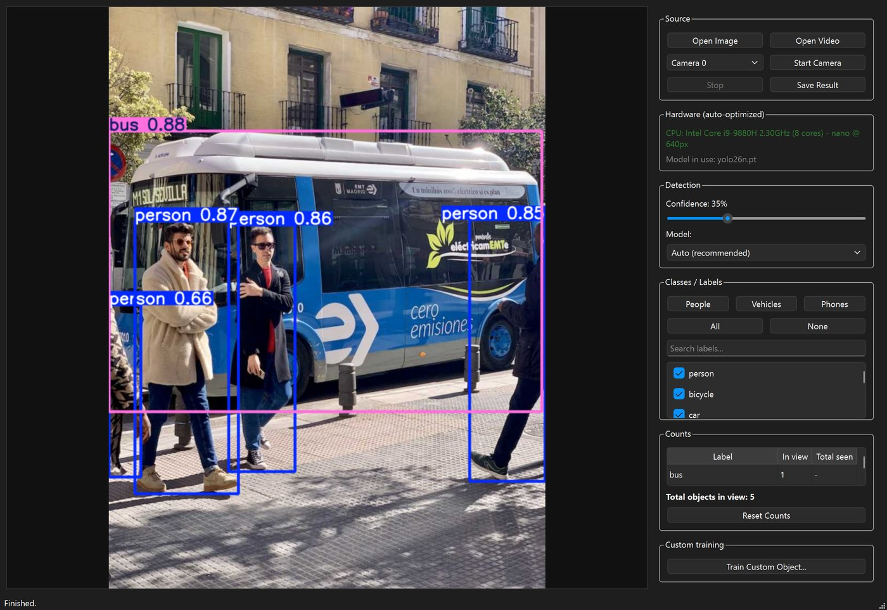

# Vision Studio

Offline **object detection and counting** for Windows, with a simple desktop
window. Point it at an image, a video file or your webcam and it tells you what
is there and how many — including how many *different* objects passed through a
video, not just how many are on screen right now.

Built on [Ultralytics YOLO26](https://docs.ultralytics.com/models/yolo26/) (the
newest released YOLO family) and PySide6. No account, no cloud: after the
one-time setup it runs without internet.



## What it does

- **Three sources** — single image, video file, or live camera.
- **Two kinds of count** — *In view* (objects on screen now) and *Total seen*
  (unique objects over the whole video or camera session, using object
  tracking, e.g. "how many distinct cars passed").
- **80 built-in labels** — person, car, cell phone and 77 more (COCO), with
  quick presets (People / Vehicles / Phones), a search box and per-label
  checkboxes.
- **Tunes itself to your hardware** — detects an NVIDIA GPU, Apple GPU or plain
  CPU and picks the model size and resolution that will run well. Shown in the
  window.
- **Teach it new objects, no command line** — a guided *Train Custom Object*
  window: snap or import photos, draw a box around the object, click Train.
- **Adjustable confidence**, model size selector (Nano → Large), and **Save
  Result** to export the annotated image.

## Setup (one time)

Requirements: Windows 10/11 and [Python](https://www.python.org/downloads/)
3.10 – 3.13.

Double-click **`setup.bat`**. It creates a private Python environment, installs
the dependencies and downloads the two smallest models (~25 MB) so the app works
offline afterwards.

Manual equivalent:

```bat
py -3.13 -m venv .venv
.venv\Scripts\activate
pip install torch torchvision --index-url https://download.pytorch.org/whl/cpu
pip install -r requirements.txt
```

## Run

Double-click **`run.bat`**, or:

```bat
.venv\Scripts\activate
python app.py
```

## How to use

1. Pick a source: **Open Image**, **Open Video** or **Start Camera**.
2. Choose which **labels** to count (presets or checkboxes). Leave everything
   ticked to detect all 80.
3. Raise **Confidence** if you get false detections, lower it if objects are
   missed.
4. Read the **Counts** panel. **Reset Counts** starts the unique totals again.
5. **Save Result** exports the current annotated frame as a PNG.

The **Model** dropdown trades speed for accuracy (Nano → Small → Medium →
Large). *Auto* picks one for your hardware. A size is downloaded the first time
you select it and kept in `models/`.

## Teach it a new object

Click **Train Custom Object...** in the main window:

1. **Project & labels** — name the project (e.g. `keys`) and add one or more
   labels (e.g. `key`, `banknote`).
2. **Collect photos** — **Start Camera** + **Snap**, and/or **Import
   Images...**. Vary the angle, distance, background and lighting. Aim for 30+
   photos per label; 100+ is much better.
3. **Label** — **Begin / Reload**, drag a box around the object in each photo,
   **Next**. Labels save automatically.
4. **Train** — choose the number of epochs (default 60) and click **Start
   Training**. Progress is shown live.
5. **Use** — click **Use this model in Vision Studio**.

Your model is saved to `models/custom_<project>.pt` and the photos to
`datasets/<project>/`, so you can retrain later. Any YOLO `.pt` file can also be
loaded with **Model → Custom model (.pt)...**.

Training on a CPU is slow (minutes per epoch on a real dataset). Start with
image size 416 and a modest dataset; an NVIDIA GPU is many times faster.

## Speed

Measured on an 8-core laptop CPU (Intel i9-9880H, no GPU acceleration),
detection only:

| Model | 448 px | 640 px |
|-------|--------|--------|
| YOLO26 nano | 34 FPS | 25 FPS |
| YOLO26 small | 19 FPS | 12 FPS |
| YOLO26 medium | 8 FPS | 5 FPS |

With an NVIDIA GPU, install the CUDA build of PyTorch for a large speed-up
(pick the command for your system at <https://pytorch.org/get-started/locally/>).

## Check your install

```bat
.venv\Scripts\activate
python selftest.py
```

Detects the hardware, loads the model and runs one detection without opening a
window.

## Project layout

| File | Purpose |
|------|---------|
| `app.py` | Main window (PySide6), background capture/inference thread |
| `detector.py` | Hardware detection, model loading, detection + tracking |
| `train_window.py` | Guided custom-training window |
| `trackers/bytetrack_robust.yaml` | Tracker settings tuned to keep IDs stable at low frame rates |
| `selftest.py` | No-window smoke test |
| `mobile/` | Experimental Flutter scaffold for Android/iOS — **not built or tested yet** |

To move to a newer YOLO family when one is released, change `MODEL_FAMILY` in
`detector.py`.

## Build a standalone .exe (optional)

```bat
pip install pyinstaller
pyinstaller --noconfirm --windowed --name "VisionStudio" ^
  --add-data "models;models" --add-data "trackers;trackers" app.py
```

## License

[AGPL-3.0](LICENSE), the same license as the Ultralytics YOLO library and model
weights this app is built on. If you need to use it in a closed-source product,
Ultralytics sells a separate [enterprise license](https://www.ultralytics.com/license).
